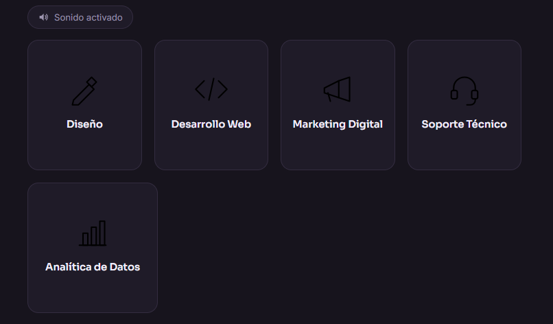
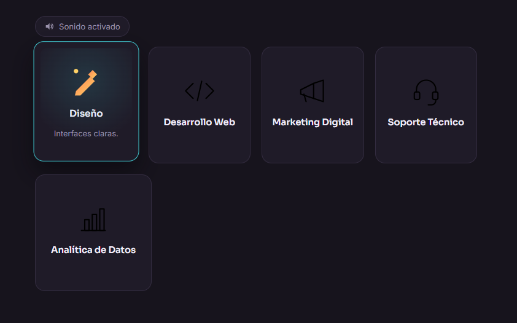

# Ecos

## Portada

**Por: Kevin Peralta Nava Peralta**

Este es un componente visual interactivo escrito en JavaScript, se trata de
una serie de tarjetas seleccionables donde, al pasar el
cursor sobre cada una este cambia
de imagen, se anima y reproduce un sonido propio.


## ¿Qué problema resuelve?

Los selectores planos (una simple lista de botones o texto) no siempre
destacan bien cada opción o el como es de distinta a ojos del
usuario sobre lo que mira. 
Este componente de **Ecos** resuelve esto dando a cada
opción de una serie una **identidad propia**: su propio ícono,
su propia imagen "activa", una animación y su propio sonido de identificación.

Sirve, por ejemplo, para:
- selectores de servicios
- selectores de iconos o avatares
- selectores de categorías/productos en una tienda
- cualquier menú donde se requiera dar feedback visual **y** sonoro por cada opción.

## ¿Cómo funciona? 

Al recibir el cursor (`mouseenter`), el foco de teclado (`focus`) o un toque
en móvil (`touchstart`) sobre una tarjeta:

1. La imagen "normal" se desvanece y aparece la imagen "hover" con una
   pequeña animación de aparición (`ec-pop`).
2. La tarjeta se eleva y se resalta con un borde y sombra.
3. Se reproduce un sonido corto asociado únicamente a esa tarjeta.
4. Al salir el cursor (`mouseleave`) o perder el foco (`blur`), todo vuelve
   a su estado normal.

Incluye un botón global para **silenciar/activar el sonido** de toda la serie.

---

## Estructura del proyecto

```
echo-cards/
├── index.html          
├── css/
│   └── componente.css  
├── js/
│   └── componente.js  
├── img/
│   ├── icon-*.svg           
│   └── icon-*-hover.svg     
├── audio/
│   └── tone-*.wav       
└── README.md
```

---

## Instalación

No requiere `npm install` ni build. Copia las carpetas `css/`, `js/`,
`img/` y `audio/` a tu proyecto y enlaza el CSS y el JS en tu HTML:

```html
<head>
  <link rel="stylesheet" href="css/componente.css">
</head>
<body>
  ...
  <div id="mi-selector"></div>

  <script src="js/componente.js"></script>
</body>
```

---

## Uso

El componente se invoca como una función, pasándole un contenedor vacío y
un arreglo de `items` con **contenido distinto cada vez** (imágenes,
sonidos y textos propios):

```html
<div id="mi-selector"></div>

<script src="js/componente.js"></script>
<script>
  new Ecos("#mi-selector", {
    items: [
      {
        label: "Diseño UI", // titulo principal
        description: "Interfaces claras y a la medida.", // descripción breve del icono, solo se revela al pasar el cursor
        image: "img/icon-design.svg",        // imagen en estado normal
        imageHover: "img/icon-design-hover.svg", // imagen al pasar el cursor
        sound: "audio/tone-design.wav"        // sonido propio de esta tarjeta
      },
      {
        label: "Desarrollo Web",
        description: "Sitios rápidos y funcionales.",
        image: "img/icon-dev.svg",
        imageHover: "img/icon-dev-hover.svg",
        sound: "audio/tone-dev.wav"
      }
      // puedes agregar tantos elementos como necesites
    ],
    soundToggle: true,  // muestra el botón para silenciar/activar sonido
    muted: false,        // true si quieres iniciar sin sonido
    onSelect: function (item, index) {
      console.log("Se hizo clic en:", item.label);
    }
  });
</script>
```

### Reutilizarlo con otro contenido

El mismo componente sirve para cualquier serie de opciones, sin tocar el
CSS ni el JS — solo cambia el arreglo `items`:

```js
new Ecos("#selector-sabores", {
  items: [
    { label: "Fresa",     image: "img/fresa.svg",     imageHover: "img/fresa-hover.svg",     sound: "audio/pop-fresa.wav" },
    { label: "Chocolate", image: "img/chocolate.svg", imageHover: "img/chocolate-hover.svg", sound: "audio/pop-choco.wav" },
    { label: "Vainilla",  image: "img/vainilla.svg",  imageHover: "img/vainilla-hover.svg",  sound: "audio/pop-vainilla.wav" }
  ]
});
```

---

## Capturas de pantalla

Componente en estado normal (Sin seleccionar)



Componente al ser sleccionado (Paso del cursor)




